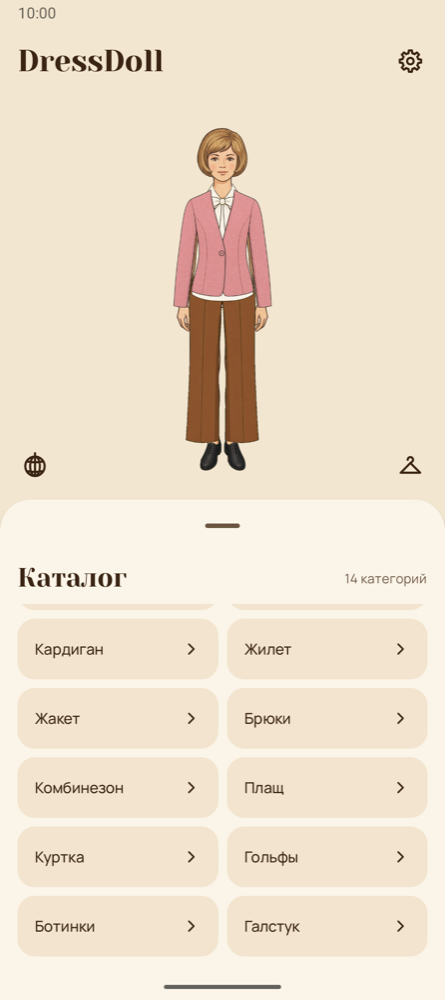
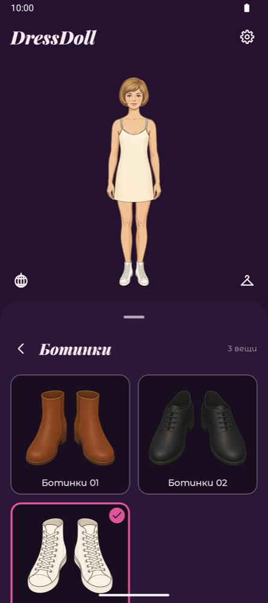
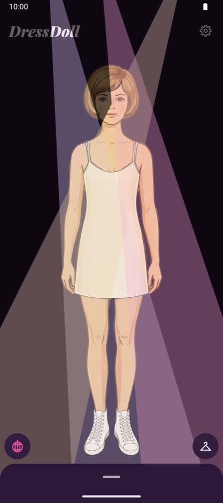
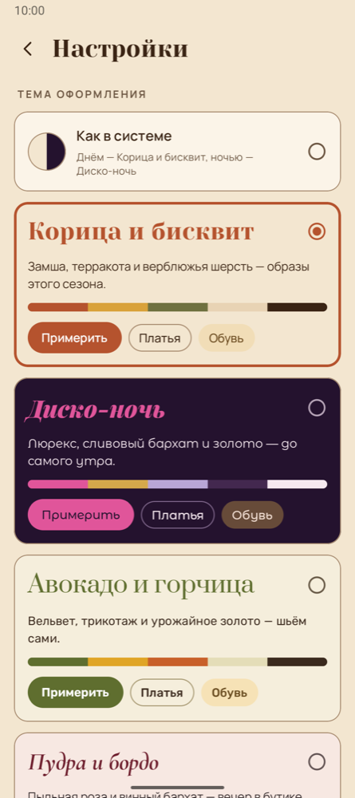

# DressDoll · Бумажная кукла

> Помните бумажных кукол из журналов 70-х? Фигурка на картоне, а вокруг платья, жакеты и ботинки с белыми клапанами, которые загибают за плечи.
> **DressDoll** берёт этот принцип: выбираете вещь из каталога, и она ложится на куклу.

**Это не игра, а прототип функции для приложения магазина одежды.** Покупатель собирает образ из вещей каталога и сразу видит, как они сочетаются на фигуре. Прототип проверяет механику примерки: правила наложения слоёв, замену вещей, анимацию и подготовку контента.

<table align="center">
  <tr>
    <td align="center" width="25%"></td>
    <td align="center" width="25%"></td>
    <td align="center" width="25%"></td>
    <td align="center" width="25%"></td>
  </tr>
  <tr>
    <td align="center"><sub>Образ в теме «Корица и бисквит»</sub></td>
    <td align="center"><sub>Каталог в теме «Диско-ночь»</sub></td>
    <td align="center"><sub>Дискотека с бумажными конусами</sub></td>
    <td align="center"><sub>Выбор темы</sub></td>
  </tr>
</table>

---

## Как это устроено

### Каталог и кукла

Каждая вещь показывается в двух видах.

| | Каталог | Кукла |
|---|---|---|
| Что видно | Вещь целиком: шейный вырез и бумажные клапаны | Вещь надета, её спинка спрятана за фигуркой |
| Зачем | Чтобы выбрать | Чтобы увидеть образ |

### Фигурка

Фигурка — нижний слой в одной позе. Положение каждой вещи на кукле задаётся в конфигурации. Другая фигура означает другие картинки вещей и другую конфигурацию.

Длина вещи — это размер её картинки. Рукав бывает до плеча, локтя или запястья, а шапка с ушами до пояса всё равно остаётся шапкой.

### Уровни: кто над кем

Вещи рисуются по уровням, снизу вверх:

```
бельё → колготки → носки → обувь → низ → майки → рубашки → галстук
      → платья → свитеры → кофты поверх свитеров → жакеты → верхняя одежда
```

Рубашку нельзя надеть поверх пиджака. Внутри одного уровня сверху оказывается вещь, надетая последней.

### Группы: кто кого заменяет

У каждой группы есть лимит вещей, которые можно надеть одновременно.

- Если лимит исчерпан, новая вещь вытесняет надетую. Куртка заменяет шубу, а два пиджака не надеть.
- Вещи из разных групп друг друга не трогают. Пальто можно носить и на голое тело, и поверх кофты.

Уровень и группа — независимые свойства. Колготки и носки лежат на разных уровнях, а колготки и чулки входят в одну группу.

Подробные правила: [.docs/doll/z-index.md](.docs/doll/z-index.md).

### Темы в духе 70-х

Пять палитр со своими шрифтами:

| Тема | Настроение |
|---|---|
| **Корица и бисквит** | замша, терракота и верблюжья шерсть — образы этого сезона |
| **Диско-ночь** | люрекс, сливовый бархат и золото — до самого утра |
| **Авокадо и горчица** | вельвет, трикотаж и урожайное золото — шьём сами |
| **Пудра и бордо** | пыльная роза и винный бархат — вечер в бутике |
| **Джинс и охра** | клёш, деним и замшевая бахрома — на всю неделю |

Режим «Как в системе» днём включает «Корицу», а ночью «Диско».

### Дискотека

Кнопка с диско-шаром приглушает экран и пускает по кукле от одного до трёх лучей в цветах палитры. Стиль лучей выбирается в настройках: ровные бумажные конусы или мягкие прожекторы.

---

## Что уже работает

- ✅ Каталог с категориями и карточками вещей
- ✅ Надевание и снятие по правилам уровней и групп
- ✅ Анимация: вещь летит на куклу, а при очистке разлетается веером
- ✅ Кнопка «снять всё»
- ✅ Образ сохраняется между запусками
- ✅ Пять тем оформления
- ✅ Режим дискотеки с цветными лучами
- ✅ Сборка проверяет датасет и генерирует из конфигурации Kotlin-код

## Что впереди

- **Режим «заправлен».** У свитера и кофты две картинки: навыпуск и заправленная. Вещь показывается заправленной, только пока надеты штаны, а выбор пользователя запоминается. Сняли штаны — свитер навыпуск, надели снова — опять заправлен.
- **Крепления.** Брошь крепится не к фигурке, а к надетой блузке или куртке, и уходит в каталог вместе с ней.
- **Клапаны.** Бумажные клапаны с анимацией загибаются за фигурку.
- **Позже.** Сохранение образов, текстура бумаги, тени, звук.

<details>
<summary>Открытые вопросы</summary>

- Уровни и группы для аксессуаров шеи, рук и головы
- Жест примерки
- Как выбрать, на какую из надетых вещей приколоть брошь
- Заправляется ли свитер в юбку
- Шарф под верхней одеждой или поверх неё
- Часы и перчатки: под рукавом или поверх
- Длинные волосы поверх пальто и под шарфом, скорее всего, отдельным слоем
- Галстук: отдельная вещь или крепление к рубашке

</details>

---

## Технологии

Kotlin · Jetpack Compose · Material 3 · Navigation 3 · Koin · DataStore · kotlinx.serialization

Проект многомодульный, каждая фича разделена на `api` и `impl`:

```
android-app/
├── app/                  точка входа
├── doll/                 экран куклы, правила надевания, анимация, дискотека
├── disco/                настройки дискотеки
├── catalog/              каталог вещей
├── outfit/               хранение надетого образа
├── repository/           доступ к вещам и категориям
├── temporary-dataset/    картинки вещей и categories.json
├── theme/                тема и пять палитр
├── settings/             экран выбора темы
├── navigation/
└── build-logic/          проверка датасета и генерация кода
```

## Сборка

Нужен Android SDK 36. Gradle использует JDK 25 (toolchain из `gradle/gradle-daemon-jvm.properties`). Минимальная версия Android — 8.0 (API 26).

```bash
cd android-app
```

```bash
./gradlew :app:installDebug
```

Тесты:

```bash
./gradlew test
```

## Контент

Картинки вещей и их конфигурацию готовят художники. Для каждой вещи нужны три картинки: для каталога (`catalog.png`), лицевая сторона (`front.png`) и спинка (`back.png`). К ним прилагается `scale.json` с положением вещи на кукле. При сборке датасет проверяется, и ошибка в конфигурации не попадёт в приложение.
